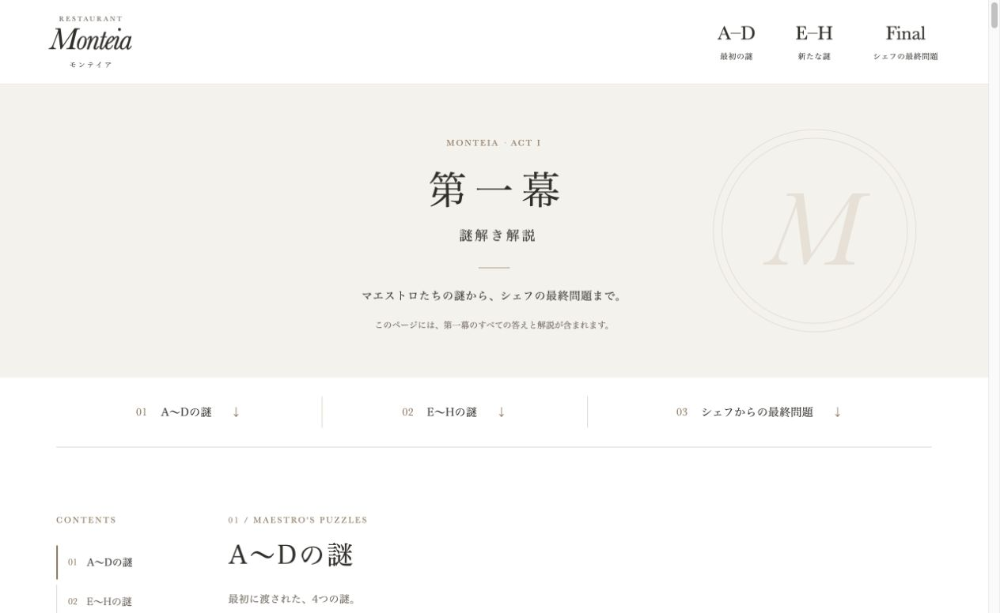

# モンテイア 第一幕の謎解き解説

「モンテイア」第一幕の解説を、文章と画像で掲載する静的サイトです。
予約管理システムとは独立して動作します。

公開ページ：[第一幕の謎解き解説](https://nazotoki-trunk.github.io/monteia-answer-site/)

## ファイル構成

- `index.html`：解説本文と画像の配置
- `assets/style.css`：レイアウトと配色
- `assets/site.js`：画像の拡大表示と目次の現在位置表示
- `assets/images/`：提供された解説画像18点

ビルドやパッケージのインストールは不要です。
JavaScriptが無効でも、本文と画像を閲覧できます。

## GitHub Pages

リポジトリの **Settings → Pages** で、**Deploy from a branch**、**main**、**/ (root)** を選択して保存します。
本文と画像には相対パスを使っているため、リポジトリのサブパスでも動作します。

## 内容の更新

本文の変更は `index.html` に反映してください。
画像を差し替える場合は、同じファイル名の画像を置き、本文中の代替テキストも確認してください。
画像の対応は提供原稿と実画像を照合し、解き直しのCに12番、Eに13番と14番を配置しています。

解説ページには検索エンジン向けの `noindex, nofollow` を設定しています。
これは検索結果への掲載を抑える指定であり、閲覧を制限する機能ではありません。
